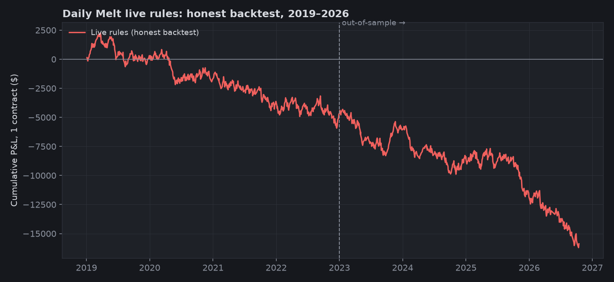
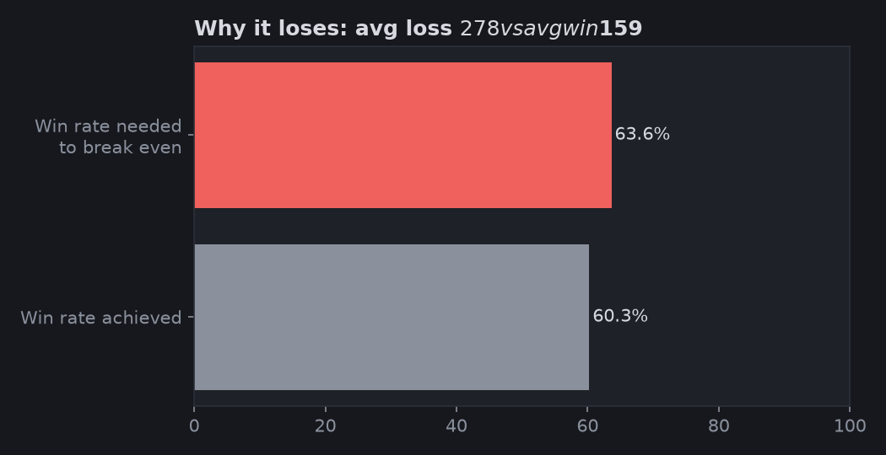
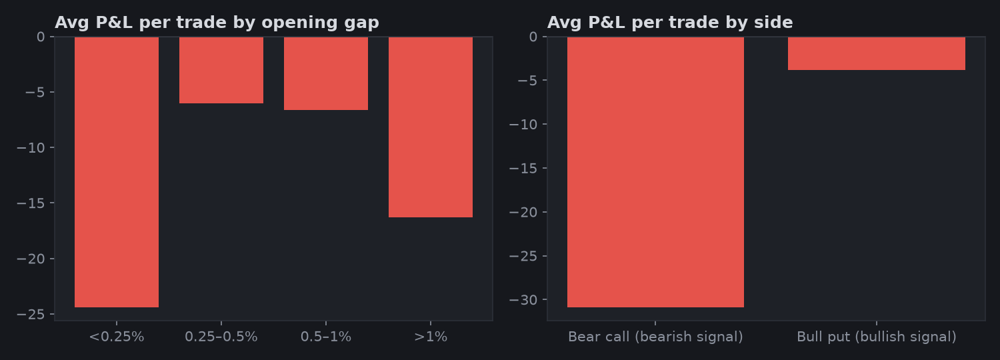
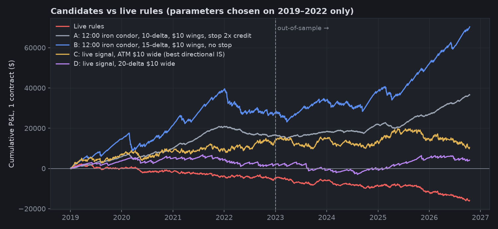
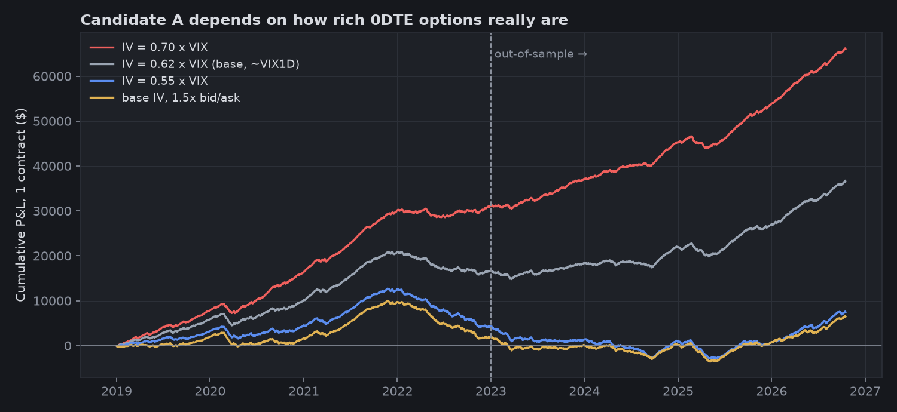

# Daily Melt strategy review: honest backtest and walk-forward

All P&L here is **simulated, per 1 contract, after costs**, unless it says otherwise. The code that produces every number is in
[`research/daily_melt_review/`](../../research/daily_melt_review/), and the raw outputs are in [`results/`](results/).
This review covers the repo at `dd37844` (the code on `main` before the `strategy-v2` branch).

## Summary

1. **The live Daily Melt rules lose money in an honest backtest.** Over 1,082 trades (2019 to Oct 2026) they lose
   **−$14.7 per trade** (PF 0.87, t = −2.2). Out of sample (2023–2026) the loss is **−$21.1 per trade**. None of the 19
   single-parameter changes tested is robustly positive out of sample.
2. **Why:** an ATM $5 vertical is close to a fairly priced coin flip. The pulse signal is real but weak. It beats a
   random side at the same entry times (98th percentile), worth about +$12 per trade. Bid/ask and commissions cost
   more than that edge (see cost attribution below).
3. **Stops and tighter targets make it worse.** They add a second round of bid/ask to a trade whose outcome is mostly
   decided at the close.
4. **The only setup that tested positive is a different strategy:** a non-directional 0DTE iron condor entered at
   12:00 ET, with 10Δ shorts, $10 wings, and a stop at 2× credit. Out of sample it made **+$20.9 per trade**. The
   anchored walk-forward made **+$28.3 per trade** (2021–2026). **It is not proven.** Its edge depends on how rich real
   0DTE quotes are. With IV at 0.55× VIX, or 1.5× bid/ask, it is roughly break-even.
5. **Next step:** keep Daily Income paused. Record real SPXW 0DTE chains in dry-run
   (`scripts/record_chains.py`) and replay the condor against real quotes before considering any live change.
   `IronCondor0DTE` is disabled by default.

## Data and model

| Part | What is used |
|---|---|
| Intraday path | Dukascopy USA500IDXUSD 1-minute bars, 1,957 sessions, Jan 2019 – Oct 16 2026. Each session is shifted so its 15:59 close equals the official ^GSPC close. Hourly changes correlate 0.981 with Yahoo ^GSPC hourly bars. |
| No look-ahead | A decision at minute *t* uses only bars closed by *t*. The bias filter uses the move from the open at the pulse bar's close. Entry is on the minute that crosses the trigger. |
| Option prices (modelled) | Black-Scholes on trading time (390 × 252 minutes). ATM 0DTE IV = **0.62 × VIX**. Median VIX1D/VIX = 0.614, and realised variance implies 0.617. Put-skew smile on top. |
| Costs | Bid/ask per leg is $0.05 + 1.5% of the price (×1.3 when VIX ≥ 25). Fills at natural on entry and ask-side on exit. An extra $0.05 on stops. $1.30 per leg per side. Settlement at the official close. |
| Live sanity check | Mar 11 – May 1 2026, bot-offline days excluded. The model and live agree on whether to trade on 23 of 34 sessions. On the 16 days both traded, they agree on win or loss 14 times. The model wins more often than live did (68% vs 43%), so if anything the backtest flatters the strategy ([`results/live_check.csv`](results/live_check.csv)). |

## Live rules (baseline)

| Period | Trades | Win % | Exp./trade | Avg win / loss | PF | Max DD | Sharpe | t |
|---|---|---|---|---|---|---|---|---|
| 2019–2022 (IS) | 555 | 61.4 | −$8.5 | $157 / −$273 | 0.92 | −$8.2k | −0.47 | −0.9 |
| 2023–2026 (OOS) | 527 | 59.0 | **−$21.1** | $160 / −$282 | 0.82 | −$11.9k | −1.13 | −2.2 |
| All | 1,082 | 60.3 | −$14.7 | $159 / −$278 | 0.87 | −$18.5k | −0.79 | −2.2 |



The break-even win rate is 63.6%, against the 60.3% achieved.

### Coin-flip benchmark

Same days, same entry minute, random side, 100 draws (`analysis.coinflip_benchmark`):

| | Exp./trade |
|---|---|
| Coin flip (mean, 5th–95th percentile) | −$27, −$37 to −$19 |
| Live pulse signal | −$14.7 (beats 98% of draws) |

### Cost attribution

All 1,082 live-rule trades (`analysis.cost_attribution`):

| Step | Total | Per trade |
|---|---|---|
| Gross at mid, no fees | +$18,005 | +$16.6 |
| Bid/ask (natural entry, ask-side exits) | −$29,474 | −$27.2 |
| Stop slippage (live rules have no stop) | $0 | $0 |
| Commissions and fees | −$4,412 | −$4.1 |
| **Net** | **−$15,881** | **−$14.7** |




## Single changes (IS 2019–22 → OOS 2023–26)

| Change | IS exp. | OOS exp. | OOS PF | OOS t |
|---|---|---|---|---|
| Live rules | −8.5 | −21.1 | 0.82 | −2.2 |
| No morning-bias filter | −7.8 | −20.8 | 0.82 | −2.2 |
| Skip \|gap\| > 0.5% | −12.4 | −21.0 | 0.82 | −1.8 |
| Ignore 9:30 bar if \|gap\| > 0.3% | −13.5 | −17.4 | 0.85 | −1.7 |
| Setups only from 10:00/10:30 bars | −15.2 | −7.8 | 0.93 | −0.7 |
| VIX ≤ 25 / VIX ≥ 15 | −3.8 / −13.9 | −22.1 / −19.9 | 0.81 / 0.83 | −2.2 / −1.8 |
| Contango only (VIX/VIX3M ≤ 1) | −11.2 | −20.4 | 0.82 | −2.1 |
| Skip FOMC days | −9.0 | −21.8 | 0.81 | −2.2 |
| Profit target 50% | −21.2 | −34.8 | 0.66 | −4.2 |
| No target (settle) | −0.1 | −12.8 | 0.90 | −1.2 |
| Stop 2× credit / 1.5× credit | −35.8 / −45.3 | −46.4 / −51.2 | 0.62 / 0.44 | −5.5 / −9.4 |
| Stop when SPX 5 pts through short | −41.0 | −50.4 | 0.40 | −10.4 |
| Flatten 15:45 | −16.0 | −27.2 | 0.75 | −3.1 |
| Short 30Δ / 20Δ / 10Δ, $5 wide | +2.4 / −5.5 / −5.6 | −6.5 / −4.3 / −4.0 | 0.90 / 0.90 / 0.78 | ≈ −0.8 |
| ATM, $10 wide | +25.2 | −6.6 | 0.97 | −0.4 |
| 20Δ, $10 wide | +3.7 | +4.1 | 1.06 | +0.4 |

"ATM $10 wide" is the best directional variant in sample and fails out of sample.

## Iron condor (non-directional)

The grid has 160 settings: entry 10:00–14:00, short 5–20Δ, $5/$10 wings, 50% target or none, 2× stop or none. Settings
were selected on 2019–22 only. Of the 160, 66 were positive out of sample, and IS vs OOS Sharpe correlate at 0.98.

| Candidate | Period | Trades | Win % | Exp./trade | PF | Max DD | Sharpe |
|---|---|---|---|---|---|---|---|
| **A: 12:00 IC, 10Δ, $10 wings, stop 2× credit** | IS | 1,006 | 70.6 | +$16.6 | 1.49 | −$5.1k | 3.0 |
| | **OOS** | 951 | 69.4 | **+$20.9** | 1.57 | −$2.9k | 3.5 |
| B: 12:00 IC, 15Δ, $10 wings, no stop | OOS | 951 | 88.1 | +$44.7 | 1.56 | −$6.7k | 2.5 |

Candidate A by year, per contract: 2019 +$5.8k, 2020 +$4.3k, 2021 +$10.8k, **2022 −$4.2k**, 2023 +$1.7k, 2024 +$3.6k,
2025 +$5.1k, 2026 YTD +$9.5k. Its worst day is −$369.



## Walk-forward report

The walk-forward is anchored (`analysis.walk_forward`, `exp5_walkforward.py`). For each year Y, the condor setting with
the best Sharpe on all data **before** Y (minimum 100 trades) is picked and then traded in Y only. The table
concatenates those out-of-sample years.

| Test year | Setting picked (entry, short Δ, wings, target, stop) | IS Sharpe | Trades | Win % | Exp./trade | PF | Total | Max DD | Sharpe |
|---|---|---|---|---|---|---|---|---|---|
| 2021 | 12:00, 15Δ, $10, none, 2× | 4.40 | 252 | 82.1 | +$76.1 | 3.13 | +$19,175 | −$1,989 | 9.13 |
| 2022 | 12:00, 15Δ, $10, none, 2× | 5.93 | 251 | 47.4 | **−$38.4** | 0.64 | **−$9,644** | −$10,521 | −3.39 |
| 2023 | 12:00, 10Δ, $10, none, 2× | 2.99 | 250 | 64.4 | +$6.8 | 1.17 | +$1,694 | −$1,950 | 1.20 |
| 2024 | 12:00, 15Δ, $10, none, 2× | 2.76 | 252 | 65.5 | +$24.3 | 1.37 | +$6,133 | −$1,760 | 2.42 |
| 2025 | 12:00, 15Δ, $10, none, 2× | 2.70 | 250 | 67.2 | +$34.7 | 1.52 | +$8,677 | −$4,568 | 3.26 |
| 2026 YTD | 12:00, 15Δ, $10, none, 2× | 2.79 | 199 | 77.9 | +$76.2 | 2.54 | +$15,168 | −$1,219 | 7.25 |
| **Combined OOS 2021–26** | | | **1,454** | **67.1** | **+$28.3** | **1.46** | **+$41,203** | **−$11,798** | **2.87** |

The procedure picks nearly the same setting every year: noon entry, $10 wings, 2× stop. That is a good sign of
stability. The 2022 year shows the risk: a trending, high-volatility year cost about a quarter of the total gain.

## Sensitivity (how much to trust the condor)



| Candidate A, OOS exp./trade | IV 0.55×VIX | **IV 0.62× (base)** | IV 0.70× | flat skew | steep skew | 1.5× bid/ask | 0.5× bid/ask |
|---|---|---|---|---|---|---|---|
| | +$3.3 | **+$20.9** | +$36.8 | +$30.5 | +$30.3 | +$4.8 | +$32.8 |

The condor makes money only if real 0DTE quotes are richer than the moves that follow. Free data cannot settle that,
which is why the next step is recording real chains.

**Go/no-go after 4–6 weeks of recorded quotes:** real-quote expectancy must be at least +$10 per contract after costs,
and the model-vs-real credit error must be under $0.10.

## Backtester fixes on the `strategy-v2` branch

These change `src/backtest/` (and the risk sizing check). They do not change live strategy behaviour.

1. Morning-bias filter evaluated at the pulse bar's close, not the full-day close (removes look-ahead).
2. Synthetic 30-minute bars are refused unless explicitly allowed. Real minute data comes from Dukascopy, aligned to the
   official close, and missing days are flagged in a `.quality.json` report.
3. 0DTE time to expiry in trading minutes, ATM IV = 0.62 × VIX (VIX1D when available), and a put-skew smile.
4. Live parity: 2.0-point minimum range, a newer pulse replaces the pending one, the 11:00 bar can't trade, entry at
   the trigger, and per-leg fees.

## Limitations

* **Option prices are modelled, not historical quotes.** This is the main caveat.
* The intraday path is an index CFD aligned to the SPX close. Opening prints can differ by a few points.
* Marks are taken once per minute, so intra-minute spikes and stop slippage on violent days may be understated.
* The live record is small (21 trades, varying contract counts), so it is only a sanity check.

## Reproducing

```bash
cd research/daily_melt_review
python fetch_daily.py          # SPX, VIX, VIX1D, VIX9D, VIX3M daily bars -> data/
python fetch_duka.py           # 1-minute Dukascopy files -> data/duka/ (slow; throttled)
python data.py                 # builds data/days.pkl
python exp1_baseline.py        # baseline, coin flip, cost attribution
python exp2_variants.py; python exp3_structures.py; python exp4_robustness.py
python exp5_walkforward.py     # walk-forward report
python charts.py; python charts_extra.py
```

`data/` is gitignored. `live_check.py` needs a private `data/live_pnl.json` of live per-day P&L, which is not
committed.
